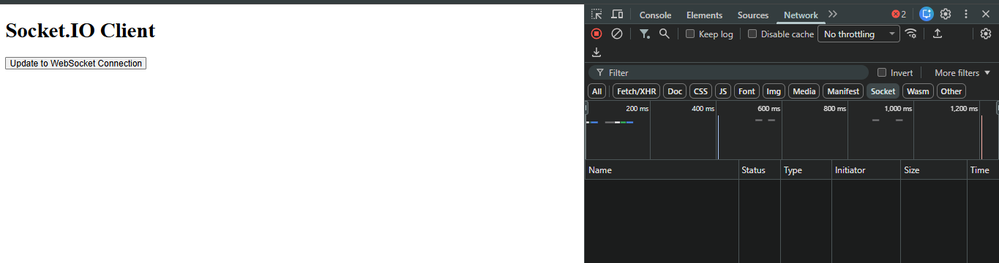
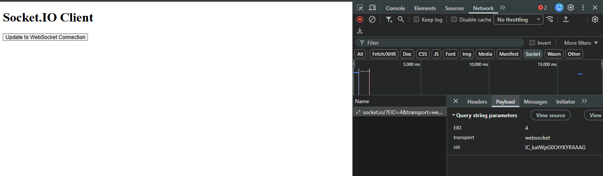

# Socket.IO Connection with Node.js

## Overview

In this practice project, I learned how to establish a Socket.IO connection between a browser client and a Node.js server.

The main goal of this practice is to understand how:

- An Express application is created.
- An HTTP server is created using Node.js.
- Socket.IO is attached to the HTTP server.
- Express serves the HTML page to the browser.
- The browser connects to the Socket.IO server.
- The server detects a successfully connected client.
- The browser's Network tab shows the connection and WebSocket transport.

**Important:** In this practice, we only implement and test the connection. We do not send chat messages between the client and server yet. Sending and receiving messages will be covered in the next practice.

## Technologies Used

- Node.js
- Express
- Socket.IO
- HTTP
- JavaScript
- HTML

## 1. Project Setup

Initialize the Node.js project if it has not already been initialized:

```bash
npm init -y
```

Install Express and Socket.IO:

```bash
npm install express socket.io
```

Set the following in `package.json` to use ES modules:

```json
"type": "module"
```

## 2. Project Structure

The existing project structure is kept. No `public` folder is created.

```text
Real-Time-Communication/
│
├── node_modules/
├── WebSocket/
│   ├── client1.html
│   └── webSocket.js
│
├── longPolling.js
├── package.json
└── package-lock.json
```

- `WebSocket/webSocket.js` contains the Express application, HTTP server and Socket.IO server.
- `WebSocket/client1.html` contains the browser-side Socket.IO client code.

Run the server command from the project root directory:

```bash
node ./WebSocket/webSocket.js
```

The static-file path in the server code is resolved relative to the directory from which this command is run.

## 3. Understanding the Setup (Step by Step)

For this practice, we have one Node.js server and one browser client. We first prepare the server, then serve the HTML page, and finally connect the browser to Socket.IO.

### Step 1: Import the Required Packages

**Server — `WebSocket/webSocket.js`**

```js
import express from "express";
import http from "node:http";
import path from "node:path";
import { Server } from "socket.io";
```

**Explanation:**

- `express` imports Express, which we use to handle HTTP requests and responses.
- `node:http` imports Node.js's built-in HTTP module. We use it to create the HTTP server.
- `node:path` imports Node.js's built-in path module. We use it to resolve the path to the folder containing our HTML file.
- `Server` is imported from Socket.IO. We use it to create the Socket.IO server.

### Step 2: Create the Express Application

```js
const app = express();
```

**Explanation:**

- This creates an Express application.
- We use `app` to register middleware and HTTP routes.
- Express will handle the HTTP requests that reach this application.

### Step 3: Create the HTTP Server

```js
const server = http.createServer(app);
```

**Explanation:**

- `http.createServer()` creates a Node.js HTTP server.
- We pass the Express application (`app`) to it.
- The HTTP server receives incoming HTTP requests and passes them to Express to handle.
- We create the HTTP server explicitly because Socket.IO will be attached to this same server.

### Step 4: Attach Socket.IO to the HTTP Server

```js
const io = new Server(server);
```

**Explanation:**

- `new Server(server)` creates a Socket.IO server.
- We pass our existing HTTP server to Socket.IO.
- This allows Socket.IO and Express to use the same HTTP server and port.
- `io` represents the Socket.IO server instance.

At this point, Socket.IO is attached to the HTTP server. The browser has not connected yet.

### Step 5: Serve Static Files from the WebSocket Folder

```js
app.use(express.static(path.resolve("./WebSocket")));
```

**Explanation:**

- `path.resolve("./WebSocket")` converts the relative folder path into an absolute filesystem path.
- `express.static()` is Express middleware that serves static files from the specified folder.
- `app.use()` registers this middleware in the Express application.
- This makes files such as HTML, CSS and client-side JavaScript available to the browser.

For example, a request for `/client1.html` can be served from `WebSocket/client1.html`.

### Step 6: Handle the Homepage Request

```js
app.get("/", (req, res) => {
    return res.sendFile(path.resolve("./WebSocket/client1.html"));
});
```

**Explanation:**

- `app.get("/")` registers a route for HTTP GET requests to the homepage.
- `req` represents the incoming request.
- `res` is used to send a response to the browser.
- `res.sendFile()` sends the specified HTML file as the HTTP response.
- We use `path.resolve("./WebSocket/client1.html")` because `client1.html` is inside the `WebSocket` folder.

When we visit `http://localhost:3000/`, Express sends `client1.html` to the browser.

**Note:** The `express.static()` middleware is registered before this route. If the static middleware finds a default `index.html` for `/`, it can serve that file before the route runs. In this project, the homepage route sends `client1.html`.

### Step 7: Listen for Socket.IO Client Connections

```js
io.on("connection", (socket) => {
    console.log("A user connected");
});
```

**Explanation:**

- `io.on("connection", ...)` listens for new Socket.IO client connections.
- When a client successfully connects, the callback executes.
- Socket.IO provides a `socket` object for that particular client connection.
- `console.log()` prints a message in the server terminal.

In this practice, we only detect the connection. We are not sending or receiving application messages yet.

### Step 8: Start the HTTP Server

```js
server.listen(3000, () => {
    console.log("Server running on port 3000");
});
```

**Explanation:**

- `server.listen(3000)` starts the HTTP server and makes it listen on port `3000`.
- The callback runs after the server has started listening.
- The server is now ready to serve the HTML page and accept Socket.IO connections.

## 4. Complete Server Code

**Server — `WebSocket/webSocket.js`**

```js
import express from "express";
import http from "node:http";
import path from "node:path";
import { Server } from "socket.io";

const app = express();

const server = http.createServer(app);

const io = new Server(server);

// Step 1: Serve static files from the WebSocket folder.
// Express can serve files such as HTML, CSS and JavaScript from this folder.
app.use(express.static(path.resolve("./WebSocket")));

// Step 2: Handle a GET request to the homepage.
// When the browser visits http://localhost:3000/,
// send client1.html as the HTTP response.
app.get("/", (req, res) => {
    return res.sendFile(path.resolve("./WebSocket/client1.html"));
});

// Step 3: Listen for Socket.IO client connections.
// This callback runs whenever a client successfully connects.
io.on("connection", (socket) => {
    console.log("A user connected");
});

// Step 4: Start the HTTP server on port 3000.
server.listen(3000, () => {
    console.log("Server running on port 3000");
});
```

## 5. Browser Client Code

**Client — `WebSocket/client1.html`**

```html
<!DOCTYPE html>
<html lang="en">

<head>
    <meta charset="UTF-8">
    <title>Socket.IO Client</title>
</head>

<body>

    <h1>Socket.IO Client</h1>

    <button onclick="upgradeToSocketConnection()">
        Update to WebSocket Connection
    </button>

    <!-- Load the Socket.IO client library provided by the server. -->
    <script src="/socket.io/socket.io.js"></script>

    <script>
        let socket;

        // Step 1: Run this function when the user clicks the button.
        function upgradeToSocketConnection() {

            // Step 2: Create a Socket.IO client and connect to the server
            // that served this page.
            socket = io();

            // Step 3: Run this callback after the Socket.IO connection
            // has been successfully established.
            socket.on("connect", () => {
                console.log("Connected to Socket.IO server");
                console.log("Socket ID:", socket.id);
            });
        }
    </script>

</body>

</html>
```

**Explanation of the client code:**

- `<script src="/socket.io/socket.io.js"></script>` loads the Socket.IO client library from the Socket.IO server.
- `let socket` declares a variable outside the function so the connection can be accessed elsewhere in this script.
- `onclick` calls `upgradeToSocketConnection()` when the button is clicked.
- `io()` creates a Socket.IO client and starts connecting to the server that served the page.
- `socket.on("connect", ...)` listens for the successful connection event.
- `socket.id` gives the Socket.IO connection's ID.

**Important:** The function name `upgradeToSocketConnection()` is our own name for the button handler. We are not manually performing the protocol upgrade. Socket.IO manages the connection and transport upgrade automatically.

## 6. What Happens When We Open the Page and Click the Button?

1. We start the Node.js server on port `3000`.
2. We open `http://localhost:3000/` in the browser.
3. The browser sends an HTTP GET request for `/`.
4. Express handles the request and sends `client1.html`.
5. The browser renders the HTML page and loads `/socket.io/socket.io.js`.
6. Before clicking the button, the client connection has not been created by our code.
7. We click **Update to WebSocket Connection**.
8. `upgradeToSocketConnection()` executes.
9. `io()` starts the Socket.IO connection process.
10. Socket.IO initially uses HTTP long-polling by default and attempts to upgrade to WebSocket when possible.
11. When the Socket.IO connection is established, the client's `connect` event executes.
12. The server's `io.on("connection", ...)` callback executes and prints `A user connected`.

## 7. Understanding the Network Tab

We used Chrome Developer Tools to observe the connection.

### Before Clicking the Button

At this point, the page is loaded, but we have not called `io()` yet. Therefore, our code has not started a Socket.IO connection.



### After Clicking the Button

After clicking the button, `io()` starts the Socket.IO connection process. In the screenshot, the Network tab shows a WebSocket connection request.



### Understanding the WebSocket Request

The request URL contains parameters similar to:

```text
ws://localhost:3000/socket.io/?EIO=4&transport=websocket&sid=...
```

| Part | Meaning |
|---|---|
| `ws://` | WebSocket protocol |
| `localhost:3000` | Our local server and port |
| `/socket.io/` | Socket.IO communication endpoint |
| `EIO=4` | Engine.IO protocol version 4 |
| `transport=websocket` | WebSocket is the selected transport |
| `sid=...` | Identifier for the Engine.IO connection |

The WebSocket handshake receives the HTTP status:

```text
101 Switching Protocols
```

This means the server accepted the protocol upgrade from HTTP to WebSocket.

**Important:** Socket.IO uses Engine.IO to manage its underlying connection. By default, it starts with HTTP long-polling and attempts to upgrade to WebSocket. The screenshot shows the WebSocket transport after the button is clicked.

## 8. Complete Connection Flow

```text
             SERVER (Node.js)                  CLIENT (Browser)
                    |                                 |
             Step 1: Start                            |
             HTTP server on port 3000                 |
                    |                                 |
                    | <-------------------------------|
                    |          HTTP GET /             |
                    |                                 |
             Step 2: Express                          |
             sends client1.html --------------------->|
                    |                                 |
                    |                    Browser loads HTML
                    |                                 |
                    |                    User clicks button
                    |                                 |
                    | <-------------------------------|
                    |          io() connects          |
                    |                                 |
             Socket.IO detects                        |
             the client connection                    |
                    |                                 |
             Step 3: connection                       |
             callback executes                        |
                    |                                 |
             Prints "A user connected"                |
                    |                                 |
                    |             Connected           |
                    |                                 |
```

## 9. What We Have Implemented

**Completed:**

- Created an Express application.
- Created an HTTP server using Node.js.
- Attached a Socket.IO server to the HTTP server.
- Served the HTML file through Express.
- Loaded the Socket.IO client library in the browser.
- Connected the browser client to the Socket.IO server after clicking a button.
- Detected the client connection on the server.
- Observed the WebSocket connection in Chrome DevTools.

**Not implemented yet:**

- Sending messages from the client to the server.
- Sending messages from the server to the client.
- Broadcasting messages to multiple clients.
- Building the chat functionality.

This practice is only about understanding and establishing the connection.

## Next Practice: Sending and Receiving Messages with Socket.IO

In the next practice, I will learn how to send messages from the client to the server and from the server to the client using Socket.IO events such as `emit()` and `on()`.

**Next Repository:** [Sending and Receiving Messages with Socket.IO]((https://github.com/MuhammadMusabYaqoob/2-WebSocket-Send-Messages-Single-User-/blob/main/README.md))

Topics to explore:

- Understanding `emit()` and `on()`.
- Sending messages from the client to the server.
- Receiving messages on the server.
- Sending messages from the server to the client.
- Receiving messages on the client.
- Understanding custom event names.
